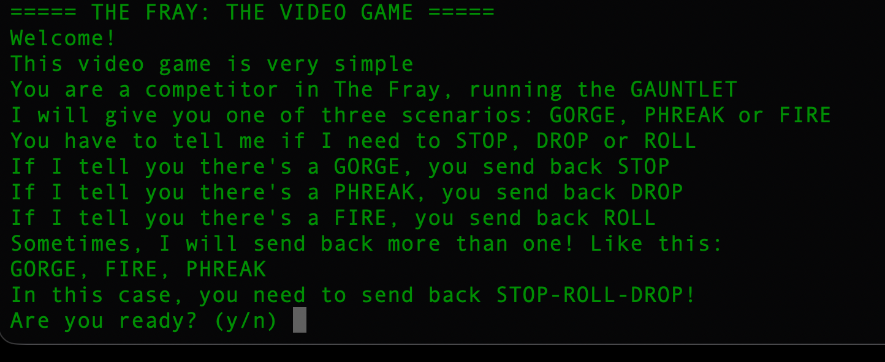

# 🎮 HTB — Stop Drop and Roll

**Category:** Misc  



## 📝 Challenge Description

In this challenge, we connect to a remote game server where we must react to different scenarios. The server sends one or more keywords, and we must respond with the correct actions to progress through the game and retrieve the flag.

## 🎯 Objective

Connect to the challenge service, interpret the scenarios, and automate responses until the flag is received.

## 🔑 Scenario Mappings

| Scenario | Required Action |
|---|---|
| `GORGE` | `STOP` |
| `PHREAK` | `DROP` |
| `FIRE` | `ROLL` |

When multiple scenarios appear, combine the corresponding actions using hyphens (`-`).

**Example:**

```text
Input:  GORGE, FIRE, PHREAK
Output: STOP-ROLL-DROP
```

## 🛠️ Tools Used

- Python 3
- TCP sockets
- Regular expressions
- Linux/macOS terminal
- Basic network protocol analysis

## 💻 Solution Approach

1. Connect to the remote challenge server.
2. Send `y` when asked to start the game.
3. Read each scenario provided by the server.
4. Map every scenario to its corresponding action.
5. Send the actions in the correct order, separated by hyphens.
6. Continue until the server returns the flag.


## 🏁 Flag

```text
HTB{...}
```
**Challenge completed!** 🚀


